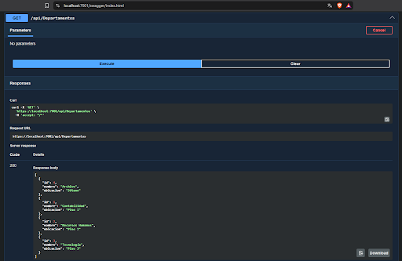
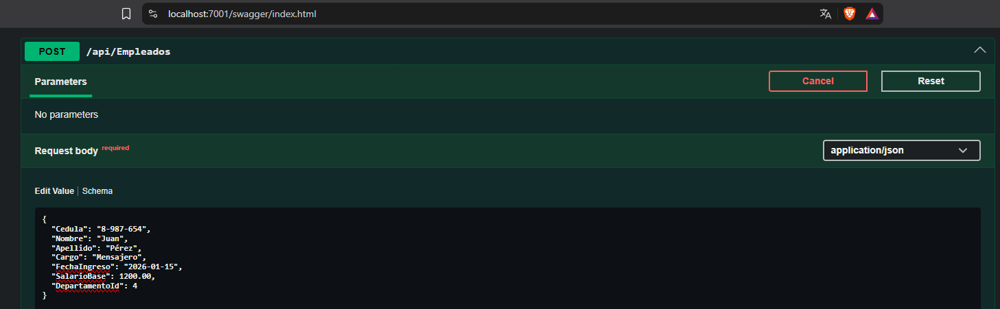
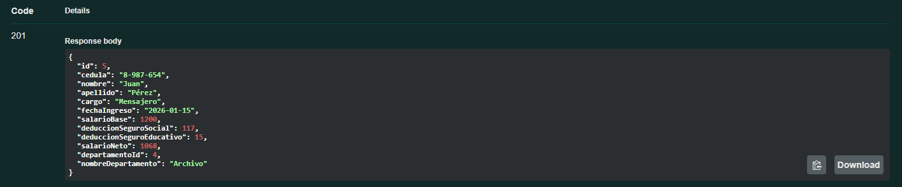
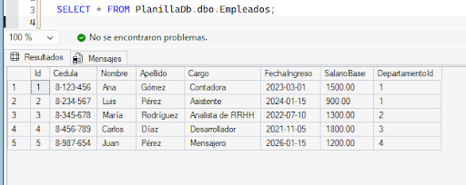
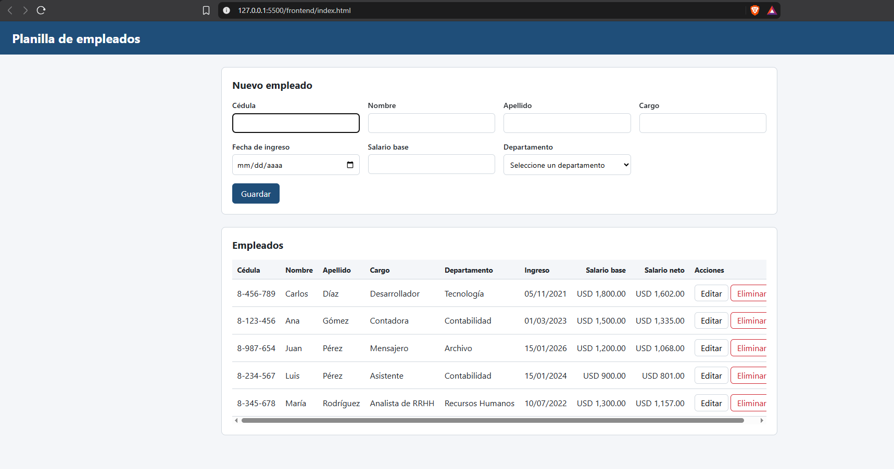

# Cómo ejecutar y probar el proyecto

Guía para clonar el repositorio y dejar funcionando la **API de Planilla** (backend) y su **frontend**.

## 1. Qué necesitas instalado

| Programa | Para qué |
| --- | --- |
| Git | Clonar el repositorio |
| Visual Studio (con la carga de trabajo **ASP.NET y desarrollo web**) y el SDK de **.NET 10** | Ejecutar la API |
| SQL Server Express y SQL Server Management Studio (SSMS) | La base de datos |
| Visual Studio Code con la extensión **Live Server** (Ritwick Dey) | Ejecutar el frontend |

## 2. Estructura del repositorio

```
planilla-api-lab/
├── .gitignore
├── README.md
├── database/        ← script SQL de la base de datos
├── backend/
│   ├── PlanillaApi.slnx
│   └── PlanillaApi/ ← proyecto de la API (C#)
├── docs/            ← esta guía y las capturas
└── frontend/        ← index.html, css/ y js/
```

## 3. Pasos para ejecutarlo

### Paso 1: Clonar el repositorio

```
git clone https://github.com/JorgeS194/planilla-api-lab7.git
cd planilla-api-lab
```

Antes de empezar a trabajar, crea tu propia rama (nunca se trabaja directo en `main`):

```
git switch -c feature/nombre-de-tu-tarea
```

### Paso 2: Crear la base de datos

1. Abre **SSMS** y conéctate a **tu** servidor local. No uses el del profesor.
2. Si no recuerdas el nombre de tu servidor, ejecuta en un New Query: `SELECT @@SERVERNAME;`
3. Abre el archivo `database/PlanillaDb.sql`, pégalo en un New Query y ejecútalo con **F5**.
4. Refresca **Databases** y comprueba que exista `PlanillaDb` con las tablas `Departamentos` y `Empleados`:

```sql
SELECT * FROM PlanillaDb.dbo.Departamentos;
SELECT * FROM PlanillaDb.dbo.Empleados;
```

### Paso 3: Configurar tu cadena de conexión

Cada integrante tiene un servidor SQL distinto, así que la cadena de conexión **no se comparte**. Crea o edita el archivo
`backend/PlanillaApi/appsettings.Development.json` (está en el `.gitignore`, así que no se sube a GitHub):

```json
{
  "ConnectionStrings": {
    "PlanillaDb": "Server=TU_SERVIDOR;Database=PlanillaDb;Trusted_Connection=True;TrustServerCertificate=True"
  },
  "Logging": {
    "LogLevel": {
      "Default": "Information",
      "Microsoft.AspNetCore": "Warning"
    }
  }
}
```

Reemplaza `TU_SERVIDOR` por el resultado del paso anterior. **La barra invertida se escribe doble** en JSON:

| Tu servidor en SSMS | Cómo se escribe en el archivo |
| --- | --- |
| `MIPC\SQLEXPRESS` | `Server=MIPC\\SQLEXPRESS` |
| `.\SQLEXPRESS` | `Server=.\\SQLEXPRESS` |
| `(localdb)\MSSQLLocalDB` | `Server=(localdb)\\MSSQLLocalDB` |

Si entras a SQL Server con usuario y contraseña en vez de Windows, usa:
`Server=TU_SERVIDOR;Database=PlanillaDb;User Id=TU_USUARIO;Password=TU_CLAVE;TrustServerCertificate=True`

### Paso 4: Ejecutar la API y probarla con Swagger

1. Abre `backend/PlanillaApi.slnx` en Visual Studio.
2. Arriba, junto al botón verde de ejecutar, elige el perfil **https** y pulsa el botón.
   La primera vez, si pregunta si confías en el certificado de desarrollo, responde **Sí**.
3. Se abre el navegador en **https://localhost:7001/swagger**. Si ves esa página, la API está corriendo.
4. Prueba `GET /api/departamentos`: pulsa **Try it out** y luego **Execute**. Debe responder **200** con la lista de departamentos.
5. Prueba `POST /api/empleados` con este cuerpo (usa un `departamentoId` que exista):

```json
{
  "cedula": "8-999-999",
  "nombre": "Prueba",
  "apellido": "Equipo",
  "cargo": "Tester",
  "fechaIngreso": "2026-01-15",
  "salarioBase": 1000.00,
  "departamentoId": 1
}
```

Debe responder **201**. Verifica en SSMS que se guardó:

```sql
SELECT * FROM PlanillaDb.dbo.Empleados;
```

> Deja la API corriendo mientras pruebas el frontend.

### Paso 5: Ejecutar el frontend con Live Server

1. Abre en **Visual Studio Code** la carpeta `frontend` (**File → Open Folder**, la que contiene `index.html`).
2. Revisa en `js/app.js` que `URL_API` use el mismo puerto de Swagger:
   ```js
   const URL_API = 'https://localhost:7001';
   ```
3. Clic derecho sobre `index.html` → **Open with Live Server** (o el botón **Go Live** de abajo a la derecha).
4. Se abre `http://127.0.0.1:5500` y debe mostrar la lista de empleados.

> El frontend **debe** abrir en el puerto **5500**: es el único que el CORS de la API permite.

## 4. Problemas comunes

| Síntoma | Causa probable | Solución |
| --- | --- | --- |
| "No se pudo conectar con la API" en el frontend | API apagada, puerto distinto en `URL_API`, o Live Server fuera del puerto 5500 | Ejecuta la API, iguala el puerto de `URL_API` al de Swagger y cierra otros Live Server abiertos |
| Error 500 en Swagger al consultar | La API no conecta a la base de datos | Revisa el nombre del servidor, la barra doble `\\` y que la base `PlanillaDb` exista |
| Advertencia de certificado en el navegador | Certificado de desarrollo sin confiar | Acepta el certificado o ejecuta `dotnet dev-certs https --trust` |
| Falta `appsettings.Development.json` | Está en el `.gitignore` y no viene con el clon | Créalo como en el Paso 3 |
| Errores en rojo en el frontend | CORS o conexión | Abre `F12` en el navegador y revisa la pestaña **Console** |

## 5. Evidencia de pruebas

Las capturas están en la carpeta `docs/img/`. Para agregar una, guarda la imagen allí con el nombre indicado y se verá en esta página.

### 5.1 Swagger: `GET /api/departamentos`



### 5.2 Swagger: `POST /api/empleados`



Resultado del post:



### 5.3 Verificación en la base de datos

Consulta ejecutada en SSMS: `SELECT * FROM PlanillaDb.dbo.Empleados;`



### 5.4 Frontend funcionando con Live Server

